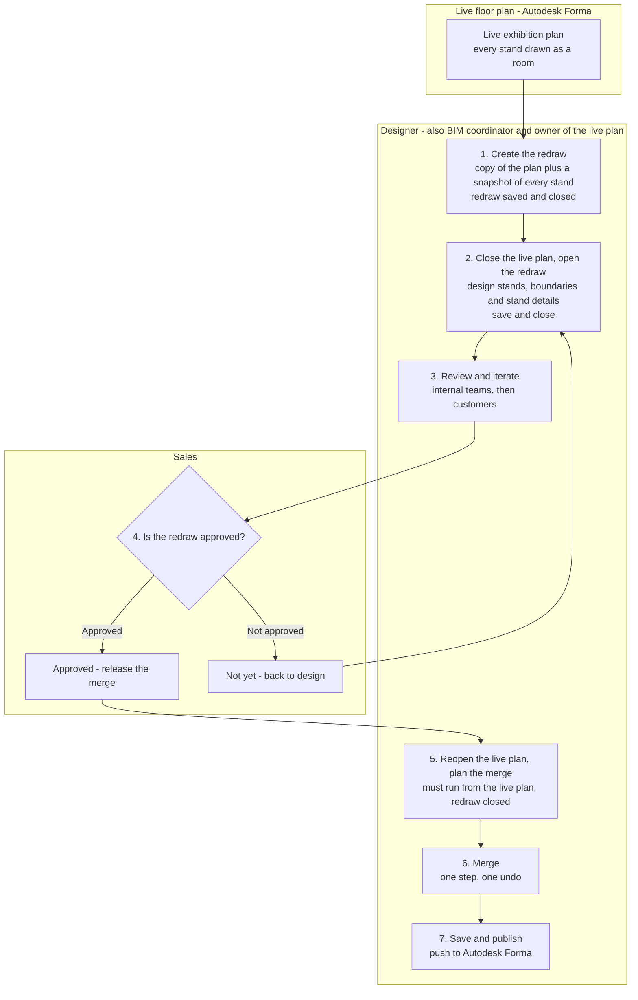
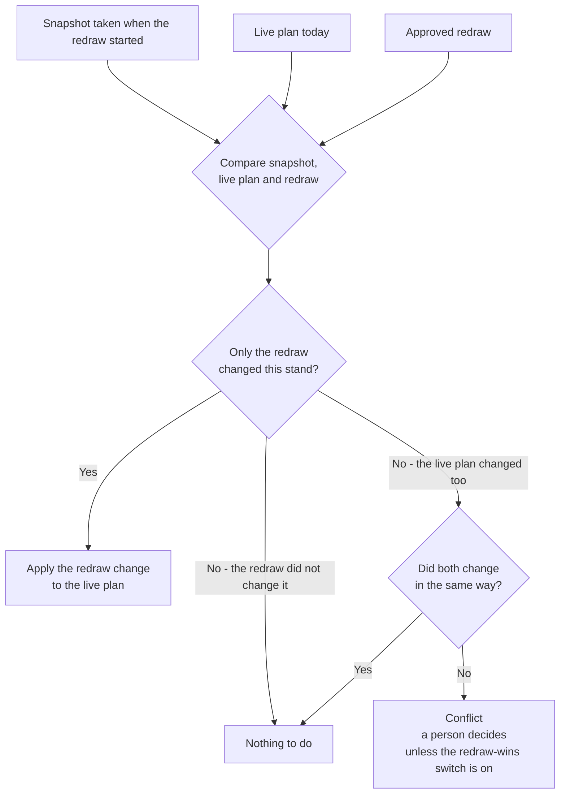
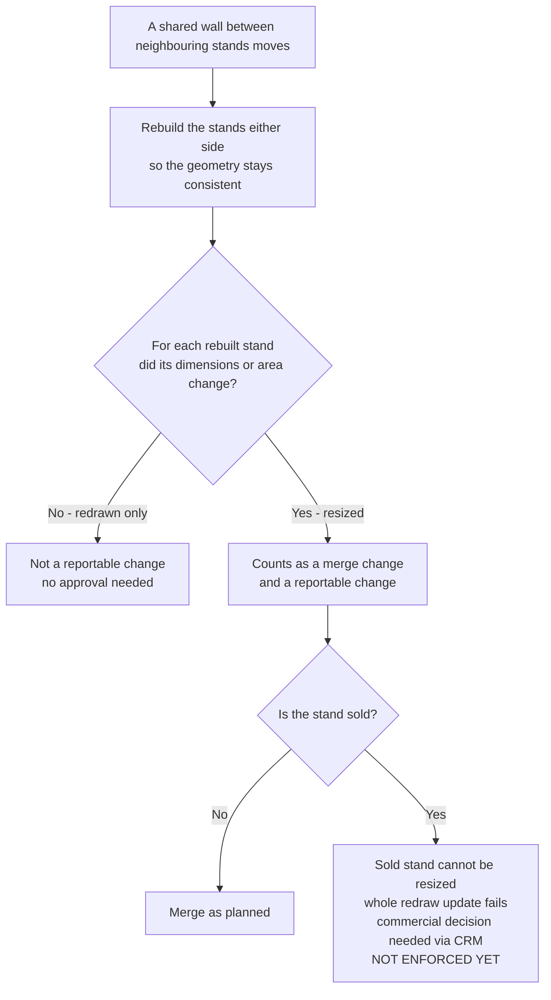

# Redraw Workflow — Business Process Overview

*Status: Draft for review · Owner: Designer / BIM Coordinator · Last updated: 2026-11-26*

> **On the diagrams.** Each diagram is a Mermaid code block. In Confluence, paste it into the Mermaid macro; if your instance does not have it, render at `mermaid.live` and upload the SVG or PNG. No diagram relies on custom CSS, so they survive re-rendering.
>
> **On the status markers.** Sections carry a status marker. **Live** describes how the process works today, checked against the current create-redraw and merge graphs. **Partly live** means some of it works today and the rest does not, and the section names the gap. **Design not started** records an intended direction that is not yet available and should not be planned around as if it were.

## 1. What this process is for

Our live exhibition floor plan is held in **Autodesk Forma** and integrates with the CRM. It is the authoritative layout for the event, and every stand on it is drawn as a room. This document explains how a change to that layout gets made, reviewed and merged back in, what counts as a change, and where the limits are.

## 2. Two routes to a change

Most changes are small and go straight into the live plan:

- a single stand amendment, or
- a small cluster of stands.

These are made directly in the live plan and reviewed as normal.

A **redraw** is used when the change is bigger — either a large number of stands is affected, or the plan needs a significant adjustment.

A redraw is a mock-up of an alternative event layout. It is built from a copy of the live plan and kept deliberately **separate and non-integrated** from it. We do this because a redraw usually has to be iterated several times — through our internal teams and then with customers — until everyone is satisfied with the new layout. None of that churn should reach the live plan or the CRM.

### A redraw is scoped as a cluster

In a trade-show layout, one wall usually separates two neighbouring stands. If that wall moves, both stands' footprints change. A redraw is therefore planned, designed and approved as a connected group of stands — a **cluster** — rather than as individual stands.

This is not a tooling constraint. It is how the layout works, and it applies however the tooling changes.

## 3. The redraw process *(Live)*

**1. Create the redraw.** The designer selects the working folder and runs the create-redraw graph. The tool copies the live plan, detaches it from the live environment, captures a **snapshot of every stand** as it stands today, saves the redraw to the working folder and closes it again, leaving the live plan active. If it cannot leave the live plan active cleanly, the Summary says so and the QA output names what to close by hand.

**2. Open the redraw and design it.** The designer closes the live plan, opens the redraw from the working folder and works in it: moves and re-shapes stands, redraws boundaries, and updates stand details — hall, pavilion, sector, obstruction area, product code and custom area. The live plan is untouched throughout. The redraw is saved and closed when the design work is done.

**3. Review and iterate.** The redraw goes to internal teams and then to customers. Feedback returns to the designer and the redraw is revised. This can repeat several times, and every revision is made in the redraw only — the live plan is not reopened until the merge is run.

**4. Approve.** Once the layout is agreed, Sales approves the redraw cluster. The designer is then cleared to merge.

**5. Reopen the live plan and plan the merge.** The designer reopens the live plan. **The merge must be run from the live plan with the redraw closed** — if the redraw is open, the tool refuses to run, because it must be certain it is comparing the right document. The merge is then run in planning mode. The tool ships with applying switched **off**, so a fresh run always plans and never edits. The planning run reports what would change, what would not, and what has been flagged as a conflict, and draws a colour-coded preview on the plan: blue for the redraw's new wall positions, amber for the live-plan walls the merge would rebuild or delete, and red for walls the live plan changed itself, which the merge leaves alone. This is reviewed before anything is applied.

**6. Merge.** The designer switches applying on and re-runs. The merge applies the plan in one transaction, so a single undo puts the live plan back where it was. Each cluster of stands is applied in its own sub-step: a cluster that fails is rolled back and reported while the other clusters still apply, so nothing is ever left half-merged, but a run can finish with some clusters skipped and the rest merged. The summary states whether the run was clean, completed with skips or conflicts, or completed with errors.

**7. Save and publish.** The designer saves the live plan and pushes it to Autodesk Forma. The redraw, and the run's log and summary files, are then archived.

### A sold stand must stop the whole redraw update *(Design not started)*

> **Not yet in the tool.** Nothing reads sold status today, so an applied merge will **not** stop and will **not** name the stand. The designer has to spot this by eye during design review (§8). The rest of this section is the intended behaviour, and §10 T1–T3 and T9 are the requirements that deliver it.

A stand that has been sold must not be resized by the designer. If the redraw would change a sold stand's area — including because a neighbouring stand's shared wall moves — **the entire redraw update must fail.** It should not be a per-stand skip, and no part of the redraw should merge.

The tool must raise an error that names the stand or stands involved, state that their area would change, and explain that a sold stand cannot be resized by the designer. Nothing may be written to the live plan when that happens.

The designer then opens the **Redraw model** and fixes the design. There are two routes:

- **Change the design** so the sold stand's area is preserved — for example by moving the shared wall, relocating the stand on the same footprint, or adjusting the neighbouring stand to suit.
- **Obtain a commercial decision through the CRM** authorising the resize. The CRM-linked plugin updates the stand's parameter on the live plan, and the designer is notified to update the stand with the new dimensions in the redraw. The redraw is then re-run.

Because the round fails as a whole, this is expensive to discover late. The sold status is visible on the live plan, so the designer should check it during step 2, before investing in review cycles with internal teams and customers. This is one of the reasons the planning run in step 5 exists — it is the cheapest place to find out that a redraw cannot merge.

## 4. How the merge decides what to apply *(Live)*

This is the part that most needs explaining, because **the merge is not a copy of the redraw.**

A redraw is built from a snapshot of the live plan taken at the start. While the redraw is being designed and reviewed, the live plan keeps moving — other people keep amending stands. So when the merge runs, it compares three things: the **snapshot** taken when the redraw started, the **live plan as it is now**, and the **approved redraw**.

The consequences in practice:

- **Newer edits already made in the live plan are kept.** Work done by other people during the redraw period is never overwritten.
- **Where both sides changed the stand differently, the stand is reported as a conflict.** With `Redraw Wins On Conflicts` off, nothing is applied and a person decides what happens. The merge graph ships with that switch **on**, which instead gives the redraw's version of that stand priority — including replacing a stand the redraw re-created even though the live plan also changed it. Switch it off when the live plan must always win.
- **A blocked geometry change does not block the stand's details.** Where a cluster is skipped or fails, the stand details that only the redraw changed — hall, pavilion, sector, obstruction area, product code, custom area — are still written. The one exception is a duplicated room number, whose details are not updated.
- **Stand details are judged one at a time.** A detail that only changed in the redraw is updated; a detail that changed in both places is flagged.

The comparison also has a tolerance: differences below one centimetre are treated as no difference at all, so a stand is only considered moved or resized if the change is real.

So the merge is a careful, selective application of the approved redraw — not the redraw's contents pasted over the live plan.

## 5. What counts as a change

There are two different counts, and they do not measure the same thing. The merge works on **clusters**, so the tool's own counts are per cluster, not per stand.

| What happened to the cluster | Counts as a **merge change** | Counts as a **reportable change** |
|---|---|---|
| A stand relocated to a new position, same size | **Yes** | No |
| A stand resized, or area changed | **Yes** | **Yes** |
| A stand re-drawn only because a shared wall moved | Counted with its cluster | No |

A stand can be re-drawn without being changed at all. That happens where a shared wall between two neighbouring stands moves: both stands may have to be rebuilt for the plan to stay consistent, but only the one whose design actually changed is a change.

The two counts answer different questions:

- **Merge changes** tell us how many clusters the merge actually alters, and are what the redraw merge report is built from. The report counts relocated, resized, added and removed clusters separately, so a cluster that only had walls rebuilt is never mistaken for a new or deleted stand.
- **Reportable changes** tell us how many stands had their size or area changed. These are the changes that matter commercially — they are what feeds reporting and the CRM, and they are what triggers customer or commercial approval where the stand is sold.

A relocation is a merge change but not a reportable change: the stand moves, but what the customer bought does not change, so nothing needs to flow to the CRM.

Because most stands in our events share walls with neighbours, the number of stands that must be rebuilt can be considerably larger than the number actually changed. Counting rebuilds as changes would overstate the size of every redraw.

The remaining gap is that the tool counts the cluster, not each stand inside it: because a cluster is one atomic change, every stand in a changed cluster is rebuilt together, and the report cannot yet say which of them were rebuilt only for consistency. Separating those out is §10 T5, and until it exists the merge report is a reliable count of clusters, not of commercially affected stands.

## 6. Who does what

| Role | Responsibility |
|---|---|
| **Designer** (also BIM coordinator and owner of the live plan) | Creates the redraw, designs it, runs and reviews the merge plan, merges, saves and publishes. Acts on any failed redraw update by fixing the Redraw model |
| **Sales** | Owns commercial approval of the redraw cluster before the merge; raises and secures customer or commercial approval where a sold stand's area changes |
| **CRM / commercial owner** | Decides and records resizes of sold stands, through the CRM. The plugin updates the stand's parameter on the live plan, and the designer is notified to update the stand with the new dimensions |
| **Customers** | Review the redraw during iteration |

Affected stands that were only rebuilt do not need separate approval.

## 7. Business rules *(Partly live)*

These rules bind the process. The last column says whether the current tool checks the rule or leaves it to people.

| Rule | Detail | Checked by the tool |
|---|---|---|
| **Sold stands are not resized by the designer** | A stand that has been sold may be relocated, but not resized. The designer does not decide to change what a customer has bought. | **No** — it is a human rule today |
| **One sold stand stops the whole redraw update** | If the redraw would change the area of any sold stand, the entire update must fail with an explanatory error. The designer opens the Redraw model and fixes the design, then re-runs. | **No** — see §8 |
| **Area changes on a sold stand need approval** | Where a stand's area changes and the stand is sold, customer or commercial approval is required before the merge is actioned. Unsold stands do not require this. | **No** — a commercial process, outside the tool |
| **Only redesigned stands are reportable** | A stand with no dimensional or area change is not a reportable change, even if it had to be redrawn or relocated (§5). | **Partly** — relocated, resized, added and removed stands are counted separately, but nothing is sent to the CRM |
| **One redraw, one merge** | Once a redraw has been merged, the same redraw cannot be merged again. Further changes to the same stand start a new redraw from the current live plan. | **Yes** — create-redraw refuses to overwrite an existing redraw and its snapshot |
| **The merge runs from the live plan** | The redraw must be closed. If the redraw is open, the merge refuses to run. | **Yes** |
| **Boundaries are captured at the wall centreline** | Stand boundaries are recorded at the centre of the wall rather than the finish face, so the redraw and the live plan are always compared on the same basis. Area is calculated on the same basis. | **Yes** |
| **Boundary wall types** | The tool works with the two standard wall types used for stand boundaries. Anything drawn differently is reworked or done by hand. | **Yes** — a cluster using another wall type is skipped and reported, not merged |
| **Room separation lines** | Not supported. A boundary drawn as a separation line must be redrawn as walls. | **Yes** — the cluster is skipped and reported |
| **A wall that carries a door, window or opening is never rebuilt** | Revit removes hosted elements with the wall and the merge cannot rebuild them, so the cluster is left alone rather than losing the opening. | **Yes** — the cluster is skipped and reported |
| **Stand details and tags follow the stand** | The six stand details are written for every stand the redraw changed. Room tags are created for added stands and re-centred for moved stands, in every view that already carries them. | **Yes** |
| **Nothing reaches Forma until saved** | The merge does not save or publish by itself. | **Yes** — the tool never saves or publishes the live plan |
| **Pilot stage** | The tooling is validated in Revit 2027 but has not yet been proven end-to-end in a live event. | — |

## 8. Where the process stops and manual work starts *(Live)*

- **Shared walls no longer stop the merge.** A cluster of stands joined by shared walls now merges as one change: walls are matched, replaced, created and deleted, and both stands either side of a moved shared wall are rebuilt so the layout stays consistent. This was the largest manual gap and it is now closed for the two standard boundary wall types.
- **The tool stops rather than guesses.** A cluster is skipped and reported — with the reason — when a wall it would touch carries a door, window or opening, when a boundary is not made of the two standard wall types or is drawn as a room separation line, when a stand sits on a different level than the snapshot, or when a room number is duplicated. Stand details for those stands are still written, so a skip costs geometry, not the whole amendment — except for a stand whose room number is duplicated, whose details are held back too.
- **Added and removed stands are now handled.** A stand the redraw added is created with its room and its room tags; a stand the redraw deleted is deleted. Both are counted separately in the report.
- **Sold stands are not checked by the tool.** Today a designer has to spot by eye that a redraw would resize a sold stand. That is the one gap where a missed check causes a commercial breach rather than a modelling inconvenience, and it is the next piece of work (§10 T1–T3).
- **Conflicts** — where the live plan and the redraw changed the same stand differently — are reported. With `Redraw Wins On Conflicts` off they are left for a person; with it on, the redraw wins automatically (§4). There is no tooling-assisted resolution beyond that switch.
- **A merge is reviewed, not trusted.** Every run writes two files next to the redraw: an append-only log with one row per cluster and per stand detail, and a summary with the counts for the run. Both are the record of what was actually applied, and both are archived with the redraw.
- **Stand heights and joins still need a visual check** after a merge, as do anything the redraw drew with non-standard walls.

## 9. Target state — shared-wall clusters *(Partly live)*

The shared-wall target is largely delivered. A cluster of stands joined by a shared wall merges as one change, and both stands either side of a moved wall are rebuilt.

Delivered today:

- **Rebuild both stands either side of a shared wall** when that wall moves, so the geometry stays consistent.
- **Report added, removed, moved and resized clusters separately**, so the run summary never conflates a new stand with a rebuilt one (§5).
- **Split a shared wall** where the two stands' new boundaries no longer align, so each stand keeps its own boundary.
- **Handle added and removed stands** rather than leaving them to hand.

Still missing — see §10:

- **Respect the sold-stand rule while rebuilding.** A rebuild that would change a sold stand's area must fail the whole redraw update, exactly as in §3. Nothing checks this yet, so a shared-wall rebuild can resize a sold stand today.
- **Resolve conflicts with a person in the loop** rather than only a global "redraw wins" switch.

That flow is live with two exceptions: the sold-stand branch at the bottom, and the per-stand split inside a rebuilt cluster — the run summary records the cluster, not each stand in it (§5, T5). Until the sold-stand check exists, the designer must catch it by eye before the merge.

## 10. Tooling requirements arising from this process

These are the capabilities the process depends on. The State column says whether each one ships today.

| # | Requirement | Why the process needs it | State |
|---|---|---|---|
| T1 | Detect sold stands whose area the redraw would change, and fail the **whole** redraw update with an explanatory error naming the stands | §3 — a sold stand must not be resized, and a partial merge must not be possible | **Not built.** The next piece of work |
| T2 | Read sold status and agreed area from the stand's Room parameter | T1 cannot work without it | **Available.** The parameter is maintained on the live plan by the CRM-linked plugin. Read it from the live plan, not the redraw — the redraw's copy was taken before the CRM update and is stale |
| T3 | Recognise an authorised resize and allow the round to proceed | Without it, an approved CRM decision cannot be actioned and the round fails every time | **Not built.** Needs the Room parameter to carry the **agreed area**, not just a sold flag. If it is only a flag, the tool cannot tell an authorised resize from an unauthorised one |
| T4 | Rebuild both stands either side of a moved shared wall | §9 — the majority of stands share walls | **Delivered.** Wall-level clustering in the merge, with per-cluster rollback |
| T5 | Distinguish merge changes from reportable changes in the merge output, and identify stands rebuilt only for consistency | §5 — otherwise the size of a redraw is overstated | **Partly delivered.** Moved, resized, added and removed stands are counted separately in the run summary; nothing is sent to the CRM |
| T6 | Surface fatal reasons to the operator | A failed run must show why, not only a status | **Delivered.** Every output is wired to a watch, and the summary carries the first reason |
| T7 | Default the merge graph to planning mode | The planning run is mandatory, so it must be the default | **Delivered.** The graph opens with applying switched off |
| T8 | Name the merge graph's output watches | The geometry output and the conflicts output must be distinguishable | **Delivered.** Summary, Parameter Updates, Geometry Updates, Conflicts / Skips, and a separate QA / Errors watch |
| T9 | Carry the sold parameter in the snapshot | The comparison needs it, so it must be part of the captured stand record. This changes the audited parameter list, which is a cross-graph contract change, not a local edit | **Not built.** Moderate; blocks T1 |

## 11. Words used in this document

| Word | Meaning |
|---|---|
| **Live plan** | The authoritative exhibition layout in Autodesk Forma |
| **Redraw** | A separate, non-integrated mock-up of an alternative layout |
| **Snapshot** | The record of every stand taken when the redraw was created |
| **Cluster** | A group of stands joined by shared walls; the unit of a redraw |
| **Sold stand** | A stand already let to a customer, carrying its sold status and agreed area as a Room parameter |
| **Merge change** | A stand the redraw moves, resizes, adds or removes; the set the merge acts on |
| **Reportable change** | A change to a stand's size or area; feeds reporting and the CRM |
| **Conflict** | A stand changed in both the live plan and the redraw, differently — decided by a person, or by the redraw when `Redraw Wins On Conflicts` is on |
| **Preview** | The planning run's colour-coded drawing on the plan of what the merge would do |
| **Skip** | A cluster the merge refuses to change because a safety rule would be broken; the reason is reported and the stand's details are still written |

---

## Document control

| Version | Date | Change | Author |
|---|---|---|---|
| 0.1 | 2026-11-21 | Initial draft, built from the current behaviour of the create-redraw and merge graphs | _TBC_ |
| 0.2 | 2026-11-26 | Refreshed against the rebuilt merge graph: shared-wall clusters, added and removed stands, the `Redraw Wins On Conflicts` switch, the planning default, the undo and partial-merge wording, and the sold-stand status corrected from live to not built (§3, §4, §5, §7, §8, §9, §10) | _TBC_ |
