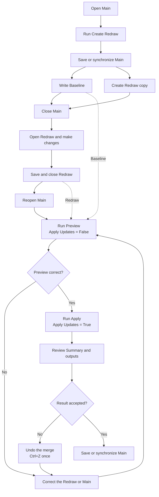

# Revit Floorplan Redraw Process — User Guide

This guide explains how to create, develop, compare, and apply a floorplan Redraw in Revit.

Use this guide with:

- Autodesk Revit 2027
- Dynamo 4.0.2
- RX Revit floorplans
- stands that are Revit Rooms
- the Room Number as the Stand Number

**Last reviewed:** 23 November 2026.

If the Dynamo graph and this guide do not agree, follow the graph. Report the difference to the BIM support team.

---

## 1. Purpose

The Redraw process lets a floorplanner develop a revised layout without changing the live Main floorplan.

The Redraw is a separate copy of Main. When the Redraw is approved, Dynamo compares it with Main and with the Baseline. Dynamo then transfers only the changes that are safe to apply.

You do not replace Main with the Redraw. Dynamo applies selected changes to Main and reports everything that it cannot apply.

### Terms

| Term | Meaning |
|---|---|
| **Main** | The live Revit floorplan. |
| **Redraw** | A separate Revit model that contains the proposed layout. |
| **Baseline** | A snapshot of Main at the moment the Redraw was created. |
| **Stand** | A Revit Room with a Room Number. The Room Number is the Stand Number. |
| **Cluster** | A group of stands that share walls. Dynamo compares and applies the group together. |

---

## 2. Process overview

The process uses three floorplan states:

| State | Purpose |
|---|---|
| **Baseline** | Shows how Main looked when the Redraw started. |
| **Main** | Shows the current live floorplan. |
| **Redraw** | Shows the proposed changes. |

The Baseline is necessary because Main can change while the Redraw is in development. Dynamo compares Main with the Baseline and the Redraw with the Baseline. This shows which side changed.

### Process diagram

The diagram shows the normal path. If your viewer does not render the diagram, use the numbered Workflow below.

Main stays the live model until Apply. The Baseline and the Redraw are separate files in the Redraw folder.

### Workflow

1. Open the correct **Main** model.
2. Run **Create Redraw**.
3. Dynamo saves Main, writes the **Baseline**, and creates the **Redraw**.
4. Close Main.
5. Open the Redraw and make the approved layout changes.
6. Save and close the Redraw.
7. Reopen Main.
8. Run **Compare and Update Redraw** with **Apply Updates** set to `False`. This is Preview mode.
9. Review the proposed changes, conflicts, and skips.
10. Correct the Redraw or Main where necessary. Run Preview again.
11. Run **Compare and Update Redraw** with **Apply Updates** set to `True`. This is Apply mode.
12. Make sure that the updated Main floorplan is correct.
13. Save or synchronize Main only after the result is approved.

The Redraw stays separate from Main until you apply the changes. Main remains the live floorplan during the whole review.

---

## 3. Before you start

### 3.1 Main

- Open the correct Main model.
- Make Main the active document.
- Save Main before you run Preview. This gives you a recovery point.
- Open the floorplan view that you want to review during Preview.
- Make sure the view is the active view. Dynamo draws the Preview in the active view only.

Dynamo does not save Main during **Compare and Update Redraw**. Save or synchronize Main yourself. If Main is workshared, synchronize it with the central model.

### 3.2 Redraw

- Close the Redraw if it is open in Revit.
- Use the approved Redraw folder.
- Make sure the folder contains exactly one primary `.rvt` file.
- Make sure the folder contains exactly one `.baseline.json` file.
- Do not put Main or any other primary model in the Redraw folder.

Dynamo ignores Revit backup files with names such as `.0001.rvt`.

### 3.3 Floorplan data

Make sure that the following are correct before you compare:

- Each Room Number is unique across the whole model.
- Each Room Number is the correct Stand Number.
- Affected stands use Revit walls on all sides.
- Affected walls use the supported wall types.
- Main and the Redraw use the expected levels.
- Main and the Redraw have the same Project Information Number. If both have a number and the numbers differ, Dynamo stops.

### 3.4 How to run a graph

1. Open the model in Revit.
2. Open Dynamo.
3. Open the graph file that the BIM support team gave you.
4. Set the inputs for this run.
5. Press **Run**.
6. Wait for the run to finish.
7. Read the **Summary** and the other outputs.

The outputs are Watch nodes at the right of the graph. Do not change the graph. If the graph shows an error, read the **QA / Errors** output. Report the error to the BIM support team.

---

## 4. Step 1 — Create the Redraw

Run **Create Redraw** from Main. Do not run it from a family document.

### 4.1 Input

**Create Redraw** has one input:

| Input | What to do |
|---|---|
| **Directory Path** | Select an empty or dedicated folder for the Redraw and the Baseline. |

The folder input is blank when the graph opens. This is intentional. Select the folder on every run.

### 4.2 What Dynamo does

1. Dynamo saves Main. If Main is workshared, Dynamo synchronizes it with the central model.
2. Dynamo keeps your workset ownership.
3. Dynamo reads every numbered Room and writes the Baseline.
4. Dynamo creates a separate, non-workshared Redraw. If Main is workshared, Dynamo detaches the Redraw from the central model and discards its worksets.
5. Dynamo saves the Redraw and closes it.
6. Dynamo makes Main active again.

**Create Redraw** works with a local, workshared, or cloud Main.

The output files use the Main model title:

- Redraw: `<Main title>.rvt`
- Baseline: `<Main title>.baseline.json`

The Baseline stores the stand boundaries on the wall centerlines. It also stores stand metadata (level, phase, design option, and workset) and nine audited parameters:

- Corners
- Floorplan Hall
- Floorplan Pavilion
- Floorplan Sector
- Obstruction Area
- Product Code
- Custom Area
- Stand Length
- Stand Width

Dynamo can merge only six of these parameters later. See section 7.3.

### 4.3 Refusals

**Create Redraw** stops if:

- Main is a family document.
- Main has never been saved and is not a cloud model.
- Main still has unsaved changes after Dynamo tries to save or synchronize it.
- the target folder does not exist.
- the target `.rvt` or `.baseline.json` already exists.
- the folder contains another primary `.rvt` or another `*.baseline.json`.
- two Rooms have the same Room Number.
- no numbered Rooms exist.
- Dynamo cannot read a Room boundary.

A blank Room Number does not stop the run. Dynamo skips that Room and adds a warning. An unplaced Room or a Room with no boundary is kept in the Baseline for audit.

To create a new Redraw for the same title, delete or rename the old `.rvt` and `.baseline.json` pair first.

### 4.4 Make sure that the result is correct

Read the **Summary** and **QA** outputs.

Expected result:

- **status** is `SUCCESS`.
- **main_active** is `True`.
- **redraw_closed** is `True`.
- **temp_central_cleaned** is `True`.
- **message** names the next action.

If the status is `SUCCESS WITH WARNINGS`, Dynamo created the Redraw but did not complete the active-document cleanup or the temporary-central cleanup. Read the **message** and the QA output. Activate Main, then close the Redraw or temporary central model by hand.

If the status is `FAILED`, no Redraw is created. Read the QA output, correct the cause, and run again.

Then continue with section 5.

---

## 5. Step 2 — Develop the Redraw

1. Close Main.
2. Open the Redraw from the approved folder.
3. Make the approved floorplan changes.
4. Save the Redraw.
5. Close the Redraw.
6. Reopen Main.

Follow these rules while you edit:

- Change the Redraw, not Main.
- Keep Room Numbers unique.
- Do not change Room Numbers unless the approved layout changes the Stand Number.
- Use `Closed Wall - RX` or `Open Wall - RX` for walls that Dynamo must rebuild.
- Keep each affected stand on its expected level.
- Keep the approved Redraw and its Baseline together in the same folder.

CAUTION: Do not change the Baseline `.baseline.json` file. The Baseline is the starting point for the three-way comparison. If you change it, Dynamo cannot tell which side made a change.

---

## 6. How the comparison works

Dynamo does not copy the whole Redraw into Main.

Dynamo compares:

- Baseline with current Main.
- Baseline with current Redraw.

The result shows what changed on each side.

### 6.1 Normal comparison rules

| Situation | Result |
|---|---|
| Neither Main nor the Redraw changed | No action |
| Only the Redraw changed | Apply the Redraw change to Main |
| Only Main changed | Keep the Main change |
| Main and the Redraw made the same change | No action |
| Main and the Redraw changed differently | Report a conflict |
| The Redraw added a stand | Create the stand in Main |
| The Redraw removed a stand | Remove the stand from Main, if the safety checks pass |
| Only Main added a stand | Keep it |
| Main removed a stand that the Redraw still has | Report `MAIN REMOVED`. Do not change Main |
| Main and the Redraw both removed the same stand | No action |

### 6.2 Why the Baseline is necessary

Example:

1. A Redraw is created on Monday.
2. On Tuesday, a floorplanner moves Stand 101 in the Redraw.
3. On Wednesday, another person moves Stand 101 in Main.
4. The two models now differ, but the difference alone does not show who changed what.
5. The Baseline shows that both sides changed Stand 101.
6. Dynamo reports a conflict. It does not overwrite one change with the other.

---

## 7. What Dynamo compares

### 7.1 Stand geometry

Dynamo compares stand boundaries and the walls that form them. It detects:

- moved stands.
- resized or modified stands.
- new stands.
- removed stands.
- new walls.
- removed walls.
- wall position changes.
- wall type, height, base offset, flipped state, and level changes.

Dynamo detects a wall change even when the wall does not move.

### 7.2 Shared walls and clusters

Two neighboring stands can share a wall. If that wall moves, both stands change.

Dynamo groups connected stands into a cluster and compares the group together. This prevents Dynamo from processing the same shared wall several times.

Dynamo applies each geometry cluster as one atomic change. If one cluster fails, Dynamo rolls back that cluster only. The other clusters can still commit.

### 7.3 Stand parameters

Dynamo compares six stand parameters:

- Floorplan Hall
- Floorplan Pavilion
- Floorplan Sector
- Obstruction Area
- Product Code
- Custom Area

The comparison uses the Baseline, current Main, and current Redraw:

| Change | Result |
|---|---|
| Neither side changed the value | No action |
| Only the Redraw changed the value | Write the Redraw value to Main |
| Only Main changed the value | Keep the Main value |
| Main and the Redraw made the same change | No action |
| Main and the Redraw changed the value differently | Report a parameter conflict |

A parameter conflict does not stop the geometry merge. Dynamo still applies the safe geometry changes in the same cluster. Dynamo never overwrites a conflicting parameter value, even when **Redraw Wins On Conflicts** is `True`.

Parameter updates are independent of geometry clusters. Dynamo can write a Redraw-only parameter change when the geometry cluster is skipped or fails. The exception is the stand with the duplicated Room Number: Dynamo does not update its parameters.

### 7.4 Rooms and Room Tags

When Dynamo applies a geometry change, it can:

- move an existing Room to the Redraw position.
- create a Room for a new stand.
- delete the Room of a removed stand.
- move a moved stand's Room Tags in every view that has them.
- create Room Tags for a new stand in every view that already carries Room Tags.

A new stand gets the tag type that each view already uses. A moved stand keeps its tag types, and its tags move to the Room's new location point.

Dynamo reports a view that does not accept a new Room Tag. The run continues.

---

## 8. Limits and safety rules

The geometry scope is deliberately controlled.

Dynamo can rebuild a wall only when the change is safe. Dynamo stops or skips a cluster instead of making a partial change.

### 8.1 Supported walls

Dynamo can create or rebuild only these wall types:

- `Closed Wall - RX`
- `Open Wall - RX`

Dynamo skips a cluster if:

- a stand boundary is not made of walls, including a boundary with a Room Separation Line.
- a wall to delete or replace is not an RX wall type.
- a Redraw wall to create is not an RX wall type.
- a wall type that Dynamo must create does not exist in Main.
- a wall level that Dynamo must use does not exist in Main.
- the Main and Redraw Room levels do not match the Baseline.
- a Main wall to delete or replace hosts a door, window, opening, or other hosted family.
- a wall that Dynamo must remove still separates two stands, or a stand and an unmanaged Room.
- a Room Number is duplicated.
- a geometry conflict is unresolved.

A stand whose Room moves away in the Redraw no longer occupies its old side. In that case, Dynamo can remove the wall it left behind if no other stand still needs it.

### 8.2 Unmanaged Rooms

Dynamo does not merge:

- a Room with a blank Room Number.
- a Room whose Room Number is duplicated.

Dynamo protects every wall that these Rooms share. It will not delete such a wall.

A duplicated Room Number quarantines the geometry of the whole cluster. Dynamo does not update the parameters of the duplicated stand. Other stands in the cluster can still get parameter updates. Review **Parameter Updates**.

### 8.3 What Dynamo does not merge

Dynamo does not merge changes to these audited parameters:

- Corners
- Stand Length
- Stand Width

If the approved result needs these changes, make them in Main by hand.

Dynamo creates a new wall without the doors, windows, openings, or other hosted families that the Redraw wall hosts. If a new Redraw wall must host one of these items, add it in Main by hand.

Dynamo does not copy wall joins or wall-type variations. Check the joins around each rebuilt wall in Main.

Dynamo also does not merge other floorplan features outside the stand workflow. Manage those features separately in Main.

### 8.4 Conflicts

A conflict occurs when Main and the Redraw both changed the same item in different ways.

This version has one global conflict setting: **Redraw Wins On Conflicts**. It cannot choose a winner for each stand or each parameter.

Dynamo skips a geometry conflict unless **Redraw Wins On Conflicts** is `True`.

The Redraw can re-create a stand with the same Number at a new position. The new stand shares no wall with the Main version. If Main also changed that stand, the cluster is a conflict. If **Redraw Wins On Conflicts** is `True`, Dynamo replaces the Main stand, including its walls.

Dynamo always reports a parameter conflict. **Redraw Wins On Conflicts** never overwrites a conflicting parameter value.

### 8.5 Sold stands

Do not resize a sold stand. A sold stand has `Status` = `Sold` on its Room in Main.

Dynamo checks sold stands before it applies a change. If a sold stand loses its area, Dynamo refuses the whole run:

- Dynamo writes nothing to Main.
- **Status** is `REFUSED`.
- **Message** names each sold stand.
- **QA / Errors** gives the reason for each stand.

Dynamo refuses the run in these cases:

- The Redraw resizes the sold stand.
- A shared wall moves and the sold stand area changes because of it.
- The Redraw deletes the sold stand.

The area comparison has a small allowance. The allowance is the larger of 0.001 square meters or the stand perimeter multiplied by the tolerance. Dynamo cannot move a wall by less than the tolerance, so a smaller allowance would refuse correct runs.

Dynamo also warns when a sold stand keeps its area but changes shape. The warning is `SOLD STAND DIMENSIONS`. The run continues. **Status** is `SUCCESS WITH WARNINGS`. Tell Sales before you publish.

Dynamo reads `Status` from Main only. The Redraw has no `Status` parameter.

The CRM plugin deletes `Status` when the model is saved. The plugin imports it again about two minutes later. If you run Dynamo before the import, Dynamo finds no `Status`:

- In Apply mode, Dynamo refuses the run.
- In Preview mode, Dynamo reports `SOLD STATUS UNAVAILABLE`.

Wait for the import. Then run Dynamo again.

Dynamo does not check `OnHold` stands in this version. Dynamo ignores `Available` stands and blank values.

---

## 9. Step 3 — Preview the Redraw

Always run Preview before Apply.

Preview compares the three floorplan states. It does not apply geometry or parameter changes to Main.

### 9.1 Inputs

| Input | Type | What it does | Saved default | Recommended use |
|---|---|---|---|---|
| **Directory Path** | Text | Selects the folder that contains the Redraw and the Baseline. | Blank | Select the approved folder on every run. |
| **Comparison Tolerance** | Number slider | Sets the geometry difference that counts as a change, in meters. | `0.0005` | Keep `0.0005` unless support instructs otherwise. See section 9.1.1. |
| **Boundary Sample Spacing** | Number slider | Sets the sampling distance for complex boundaries, in meters. | `0.25` | Keep `0.25` unless support instructs otherwise. |
| **Apply Updates** | Boolean selector | Selects Preview or Apply mode. | `False` | Use `False` for Preview. Use `True` for Apply. |
| **Redraw Wins On Conflicts** | Boolean selector | Lets Redraw geometry win a geometry conflict. | `True` | Make sure that this input is correct before every run. See section 9.2. |

The graph has one text input, two number sliders, and two Boolean selectors. Use the selectors for the Boolean values. Do not type these values as text.

When the graph opens, the inputs show these values:

- tolerance slider: `0.0005`
- spacing slider: `0.25`
- **Apply Updates**: `False`
- **Redraw Wins On Conflicts**: `True`

Use these values to identify the inputs.

Dynamo refuses a blank directory, a tolerance that is not a number or is negative, and a spacing that is not a positive number. Dynamo warns when the spacing is much larger than the tolerance.

### 9.1.1 What the tolerance does

The tolerance does not control how closely Dynamo draws a wall. Dynamo builds a new wall from the Redraw curve. The new wall is exact.

The tolerance decides if an existing Main wall is the same wall as the Redraw wall:

- If the wall is the same, Dynamo keeps the Main wall.
- If the wall is different, Dynamo replaces it with the Redraw wall.

Keep the tolerance small. A small tolerance makes Dynamo replace more walls. The stand areas then match the Redraw.

The saved value is `0.0005` (0.5 mm). Do not increase it without support. A larger value can keep a Main wall that is not in the same position as the Redraw wall. The stand area then does not match.

### 9.2 The Redraw-wins default

The saved graph sets **Redraw Wins On Conflicts** to `True`. The code fallback is `False` when the input is missing.

Use this procedure:

1. Set **Redraw Wins On Conflicts** to `False` for the first Preview.
2. Review every reported conflict.
3. Decide which version must win.
4. If the approved decision is that the Redraw geometry replaces Main, set it to `True`.
5. Run Preview again with the final setting.
6. Apply with the same setting that you reviewed.

When **Redraw Wins On Conflicts** is `True`, Dynamo still reports each conflict. The run status can therefore be `SUCCESS WITH WARNINGS` even when Dynamo resolves the conflict with the Redraw geometry.

### 9.3 Preview procedure

1. Open Main.
2. Open the floorplan view that you want to review.
3. Make sure Main is the active document.
4. Save Main.
5. Close the Redraw.
6. Open **Compare and Update Redraw**.
7. Select the **Directory Path**.
8. Set the **Comparison Tolerance** slider to `0.0005 m`.
9. Set the **Boundary Sample Spacing** slider to `0.25 m`.
10. Set **Apply Updates** to `False`.
11. Set **Redraw Wins On Conflicts** to the value that you want to review.
12. Run Dynamo.
13. Read the **Summary**.
14. Make sure that **Mode** is `DRY RUN`.
15. Review the colored changes in the active view.
16. Review **Parameter Updates**.
17. Review **Geometry Updates**.
18. Review **Conflicts / Skips**.
19. Review **QA / Errors**.

Dynamo opens the Redraw for reading and closes it at the end of the run. The Redraw appears in Revit's document switcher while Dynamo reads it. Do not edit it during the run. Dynamo does not link the Redraw into Main.

### 9.4 What Dynamo examines before it continues

Dynamo stops before the merge if:

- the active document is the Redraw.
- the Redraw is open in Revit.
- the folder does not contain exactly one primary `.rvt` and one `*.baseline.json`.
- the Baseline schema or snapshot type is wrong.
- the Baseline filenames do not match the files in the folder.
- the Baseline merge-parameter list does not match the graph.
- the Baseline boundary location is not `Center` or `Finish`.
- the Baseline has no stands.
- the Project Information Number differs between Main and the Baseline.

Dynamo reports a warning when either model has no Project Information Number. It continues in that case. The warning appears in **Conflicts / Skips** as `IDENTITY WARNING`.

---

## 10. Understand the Preview colors

Dynamo draws the Preview in the **active view**. Open the plan view that you want to review before you run Preview.

| Color | Meaning |
|---|---|
| **Blue** | New Redraw wall, or the new position of a replaced wall. |
| **Amber** | Existing Main wall that Dynamo will remove or replace. |
| **Red** | Existing Main wall that Dynamo keeps. Main added it after the Redraw was created. |
| **Magenta** | Dynamo skipped this cluster. |

A moved wall can show two colors:

- **amber** at its current Main position.
- **blue** at its proposed Redraw position.

Magenta is not an instruction to apply the cluster. Read **Conflicts / Skips** and **QA / Errors** to find the reason.

The colors are a visual aid. The text outputs are the authoritative record of the plan.

The Preview shows geometry only. Parameter changes appear in **Parameter Updates**, not as colors.

Preview is a separate transaction. The next run removes the old Preview before it draws a new one. Apply also removes the old Preview before it starts the merge.

CAUTION: A dry run leaves temporary preview elements in Main. Do not save or publish Main while a Preview is on the plan. The next run removes the Preview, or you can press Ctrl+Z once to remove the Preview that the run drew.

---

## 11. Review the outputs

**Compare and Update Redraw** has five outputs:

| Output | What it tells you |
|---|---|
| **Summary** | The run status, mode, counts, audit result, and the first reason for a warning. |
| **Parameter Updates** | Stand parameter changes. |
| **Geometry Updates** | Planned or completed geometry changes, one entry per cluster. |
| **Conflicts / Skips** | Conflicts, skipped changes, identity warnings, and stands that Main removed but the Redraw still has. |
| **QA / Errors** | Warnings, cluster details, timing, and fatal errors. |

### 11.1 Summary fields

| Field | Values | Meaning |
|---|---|---|
| **Status** | `SUCCESS`, `SUCCESS WITH WARNINGS`, `COMPLETED WITH ERRORS`, `REFUSED`, `FAILED` | Overall result. |
| **Message** | Text | The first skip, conflict or sold-stand reason. For a failed run, a failure count and a pointer to QA. |
| **Mode** | `DRY RUN`, `APPLIED` | Preview or Apply. |
| **Audit** | `OK`, `FAILED`, `SKIPPED` | Result of the CSV audit write. |
| **Clusters** | Number | Geometry clusters planned or verified in this run. |
| **Parameters** | Number | Parameter changes planned or verified. |
| **Geometry** | Number | Geometry changes planned or verified. This value equals **Clusters** because each cluster is one geometry entry. |
| **Rooms created** | Number | Rooms created for stands that the Redraw added. |
| **Skipped** | Number | Changes that Dynamo did not process. |
| **Errors** | Number | Failed or verification-failed changes. |
| **Conflicts** | Number | Geometry and parameter conflicts. |
| **Sold status** | `PRESENT`, `MISSING` | Shows if Dynamo found the `Status` parameter in Main. |
| **Sold stand blocks** | Number | Sold stands that would change area. An Apply run refuses these. |
| **Sold stand warnings** | Number | Sold stands that keep their area and change shape. |
| **Redraw document closed** | `YES`, `NO`, `NOT OPENED` | Result of closing the Redraw document. |
| **Preview** | Text | What the Preview drew or cleared. |
| **Undo** | Text | The transaction to undo, or `NOT REQUIRED`. |
| **Error** | Text | The refusal or fatal reason. This field appears only when **Status** is `REFUSED` or `FAILED`. |
| **Trace** | Text | The Python trace. This field appears only when **Status** is `FAILED`. |

### 11.2 Status meanings

| Status | Meaning |
|---|---|
| `SUCCESS` | No change failed, no change was skipped, and no conflict was reported. |
| `SUCCESS WITH WARNINGS` | The run completed, but one or more changes were skipped, one or more conflicts were reported, or a sold stand changed shape. |
| `COMPLETED WITH ERRORS` | One or more changes failed, or one or more changes failed verification. |
| `REFUSED` | A safety rule stopped the run before Dynamo wrote anything. Read **Error** and **QA / Errors**. Fix the Redraw or wait, then run again. There is no trace because this is not a fault in Dynamo. |
| `FAILED` | The run stopped before it completed. Read **Error**, **Trace**, and **QA / Errors**. |

A `SUCCESS` status does not prove that every Redraw change was applied. It proves that nothing was skipped, conflicted, or failed. A run with nothing to merge also reports `SUCCESS`. Read the counts to make sure that Dynamo saw the expected changes. Always review the detailed outputs.

### 11.3 Change statuses

| Status | Meaning |
|---|---|
| `PLANNED` | Preview will apply this change in Apply mode. |
| `APPLIED` | Apply wrote this change. Verification runs next. |
| `VERIFIED` | Main matches the Redraw after Apply. |
| `SKIPPED` | Dynamo did not apply this change. The reason is in **Conflicts / Skips** or **QA / Errors**. |
| `FAILED` | Dynamo did not apply this change. |
| `VERIFY_FAILED` | Main does not match the Redraw after Apply. |

In Preview mode, changes are `PLANNED` or `SKIPPED`. `APPLIED`, `VERIFIED`, and `VERIFY_FAILED` occur only in Apply mode.

**Geometry Updates** also shows the cluster change type:

- `MOVED`
- `RESIZED`
- `ADDED`
- `REMOVED`
- `MIXED`

`MIXED` means the cluster contains more than one kind of change.

---

## 12. Conflicts

A conflict occurs when Main and the Redraw both changed the same item from the Baseline in different ways.

Example:

1. The Baseline has Stand 101 in position A.
2. Main moves Stand 101 to position B.
3. The Redraw moves Stand 101 to position C.
4. Dynamo detects that both sides changed.
5. Dynamo reports a geometry conflict.

A parameter conflict occurs in the same way for one of the six merged parameters.

### What to do

1. Read the conflict in **Conflicts / Skips**.
2. Compare Main, the Redraw, and the approved layout.
3. Correct Main or the Redraw so that only one required change remains.
4. Run Preview again.
5. If the approved decision is that the Redraw geometry must replace Main, set **Redraw Wins On Conflicts** to `True` and review the conflict again.

Do not use **Redraw Wins On Conflicts** to hide an unresolved design decision. It changes geometry only. It never resolves a parameter conflict.

---

## 13. When not to Apply

Do not run Apply if:

- **Status** is `FAILED`.
- the run reports unexpected errors.
- the wrong Main or Redraw is selected.
- the Baseline does not match the Redraw.
- an unexpected area is magenta.
- Dynamo reports an unsupported wall type.
- a stand uses a boundary that is not made of walls.
- a wall hosts a door, window, opening, or other hosted family.
- Main and the Redraw use different levels.
- a geometry conflict is unresolved.
- a parameter conflict affects the required result.
- the Preview does not match the approved Redraw.
- **Redraw document closed** is `NO` and you have not closed the Redraw by hand.

Correct the problem. Run Preview again. Apply only after the Preview is correct.

---

## 14. Step 4 — Apply the Redraw

Run Apply only after you review and accept the Preview.

CAUTION: Apply changes the live Main model. Make sure that you saved Main and selected the correct Redraw folder before you run Apply.

If Main changes after the Preview, run Preview again before Apply.

### 14.1 Procedure

1. Make sure that Main is open and active.
2. Make sure that the Redraw is closed.
3. Save or synchronize Main. This gives you a recovery point.
4. Keep the reviewed Preview result available.
5. Decide the **Redraw Wins On Conflicts** setting.
6. Set **Apply Updates** to `True`.
7. Use the same **Redraw Wins On Conflicts** setting that you reviewed.
8. Run Dynamo once.
9. Wait for the run to finish.
10. Read **Summary**. Make sure that **Mode** is `APPLIED` and **Audit** is `OK`.
11. Review **Parameter Updates**.
12. Review **Geometry Updates**.
13. Review **Conflicts / Skips**.
14. Review **QA / Errors**.
15. Inspect the affected areas in Revit.
16. Save or synchronize Main only after you approve the result.

Apply runs in two transactions:

1. `Redraw Merge - Clear Preview` removes the old Preview.
2. `MVP2.4B6 - Merge Redraw Updates` applies the changes.

Each geometry cluster runs in a sub-transaction of the merge. A cluster that fails is rolled back. The other clusters can still commit.

### 14.2 Apply outcomes

| Outcome | What it means |
|---|---|
| `SUCCESS` | All planned changes applied and verified. |
| `SUCCESS WITH WARNINGS` | Some changes applied, but at least one change was skipped or a conflict was reported. |
| `COMPLETED WITH ERRORS` | At least one change failed or failed verification. Review the affected clusters. |
| `FAILED` | Dynamo stopped. If the failure occurred during the merge, the merge transaction rolled back. |

A failed geometry cluster is rolled back. The other clusters stay applied. The run reports `COMPLETED WITH ERRORS`. Undo the merge to remove the clusters that did apply.

---

## 15. What Apply can change

### 15.1 Walls

Dynamo can:

- keep existing Main walls.
- delete Main walls that the Redraw removed.
- create Redraw walls that Main does not have.
- replace Main walls with the Redraw version when position or attributes differ.

A replacement deletes the Main wall, then creates the Redraw wall. Dynamo copies the Redraw wall's type, height, offset, flipped state, and level. If the height cannot be read, Dynamo uses 10 ft.

Dynamo keeps a wall that Main added after the Redraw was created. The exception is a conflicted stand that the Redraw re-created, when **Redraw Wins On Conflicts** is `True`.

### 15.2 Stands

Dynamo can:

- move existing Rooms.
- create Rooms for stands that the Redraw added.
- delete Rooms for stands that the Redraw removed.

### 15.3 Room Tags

Dynamo can:

- move a moved stand's Room Tags in every view that has them.
- create Room Tags for a new stand in every view that already carries Room Tags.

A new stand gets one Room Tag per view that has Room Tags, using the type that the view already uses. Dynamo places the tag on the Room location point. If the model has no Room Tags, Dynamo creates one tag in the active view with the default type.

### 15.4 Parameters

Dynamo can write these six parameters when only the Redraw changed them:

- Floorplan Hall
- Floorplan Pavilion
- Floorplan Sector
- Obstruction Area
- Product Code
- Custom Area

Dynamo skips a parameter write if the parameter is missing in Main, is read-only, or is not a text parameter.

When Dynamo updates an existing stand, a parameter with no value in the Redraw writes a blank string to Main. For a new stand, Dynamo writes only the merged parameters that have a value in the Redraw. QA reports each missing parameter.

---

## 16. Examine the completed update

After Apply, inspect the changed area in Revit.

Make sure that the following are correct:

- stand positions.
- stand dimensions and boundaries.
- shared walls.
- new stands.
- deleted stands.
- wall types, heights, offsets, and levels.
- Room locations.
- Room Tags in every affected view.
- neighboring stands.
- updated stand parameters.

After Apply, Dynamo compares each applied cluster with the Redraw. A cluster whose geometry does not match the Redraw is reported as `VERIFY_FAILED`. A parameter whose Main value does not match the Redraw is also reported as `VERIFY_FAILED`.

Do not publish the updated Main model until you review the result.

---

## 17. Undo and recovery

Apply edits Main in one merge transaction:

`MVP2.4B6 - Merge Redraw Updates`

One Ctrl+Z reverses the merge.

A dry run edits Main only to draw the Preview. One Ctrl+Z removes the Preview that the run drew.

The Preview is a separate transaction. Apply removes the old Preview before the merge. If you undo the merge, Revit does not restore the Preview graphics.

A geometry cluster that failed was rolled back during Apply. Undo does not need to remove it.

Undo is a recovery tool. It is not a replacement for Preview, review, and a saved Main model.

---

## 18. Audit files

Dynamo writes two CSV files next to the Redraw:

- `<Redraw title>.merge-log.csv`
- `<Redraw title>.merge-summary.csv`

The log appends one row for each cluster and one row for each parameter decision. A cluster row records its change type, status, wall counts, parameter count, tag count, and reason. The summary is rewritten on each run.

The `mode` column is `PREVIEW` or `APPLIED`.

The summary row has these columns:

- `clusters_merged`, `clusters_skipped`, `clusters_moved`, `clusters_resized`, `clusters_added`, `clusters_removed`
- `walls_replaced`, `walls_created`, `walls_deleted`, `params_written`, `tags_moved`, `conflicts`

A failed run writes a `RUN FAILED` row when Dynamo can find the folder. If Dynamo cannot write the files, the **Audit** field in **Summary** shows `FAILED` or `SKIPPED`.

Treat the audit files as project records. They can contain stand data. Do not publish them.

---

## 19. Common refusals

| Message or symptom | What to do |
|---|---|
| `Select the Redraw directory (the folder that holds one .rvt and its .baseline.json).` | Select the approved Redraw folder. |
| `Redraw directory is invalid` | Make sure that the **Directory Path** is an existing folder. |
| `Redraw directory must contain one primary RVT` | Keep exactly one main `.rvt` file in the folder. Remove extra models. |
| `Redraw directory must contain one baseline JSON` | Put exactly one matching `.baseline.json` file in the folder. |
| `Active document is the Redraw. Open Main before running Compare and Update Redraw.` | Open Main and run Compare and Update Redraw from Main. |
| `Close the Redraw before running Compare and Update Redraw.` | Close the Redraw document in Revit. |
| `Target directory does not exist` | Select a folder that exists. |
| `Run from an open Revit project model.` | Open a project model, not a family document. |
| `Save Main once before running Create Redraw.` | Save Main, then run Create Redraw again. |
| `Main still has unsaved changes after save/sync` | Save or synchronize Main by hand, then run Create Redraw again. |
| `No numbered rooms were available for the baseline.` | Give at least one Room a Room Number. |
| `Baseline extraction has errors. Resolve ERROR entries before creating Redraw.` | Read the QA output and correct each ERROR. |
| `Redraw or baseline already exists` | Delete or rename the old Redraw and Baseline pair before you run Create Redraw. |
| `Target directory must contain no other primary RVT files` | Use an empty or dedicated folder. |
| `Target directory must contain no other baseline JSON files` | Keep only the new pair in the folder. |
| `Baseline schema_version is not 1.0` or `Baseline snapshot_type is not REDRAW_BASELINE` | Use the Baseline that Create Redraw wrote. |
| `Baseline does not match Redraw RVT` or `Baseline sidecar identity mismatch` | Select the matching Redraw and Baseline pair. |
| `Baseline boundary_location must be Finish or Center` | Use a Baseline that Create Redraw wrote. |
| `Baseline merge parameter list differs from graph` | Use the Baseline that matches this graph version. |
| `Baseline stands are missing or empty` | Use a Baseline that contains stands. |
| `Baseline project number does not match active Main` | Stop. You have the wrong Redraw, Baseline, or Main model. |
| `Duplicate Room Number` | Make each Room Number unique in Main and the Redraw. |
| `Main Room level differs from baseline` or `Redraw Room level differs from baseline` | Correct the Room level, or add the required level to Main. |
| `Main and Redraw Room levels differ` | Put both Rooms on the same level. |
| `No level in Main for this cluster` or `Level not found in Main` | Add the level to Main, or correct the wall level in the Redraw. |
| `Main wall ... hosts ... doors/windows/openings` | Remove the hosted items in the Redraw, or handle the change by hand. |
| `Wall type not found in Main` | Add the wall type to Main, or use an RX wall type that Main already has. |
| `Unsupported Main wall type` or `Unsupported Redraw wall type` | Use `Closed Wall - RX` or `Open Wall - RX`. |
| `Stand ... has a boundary that is not made of walls` | Rebuild the boundary with Revit walls, not Room Separation Lines. |
| `The Redraw removes a wall that still separates` | Keep the wall in the Redraw, or delete the neighboring stand in the Redraw. |
| `Main and the Redraw changed this cluster differently` | Review the conflict, or set **Redraw Wins On Conflicts** to `True` if the Redraw must win. |
| `Main and the Redraw disagree about a wall` | Review the wall in both models, or set **Redraw Wins On Conflicts** to `True` if the Redraw must win. |
| `The new stand is not in an enclosed region` | Close the Redraw walls around the new stand, then run Preview again. |
| `The Main Room could not be moved` or `The new Room could not be moved` | Move the Room by hand, or correct the Redraw Room, then run Preview again. |
| `The comparison tolerance must be` | Enter a number of meters that is zero or greater. |
| `The boundary sample spacing must be` | Enter a number of meters that is greater than zero. |
| `Redraw parameter cannot be written safely` | Correct the Redraw parameter value. |
| `Parameter not found in Main` or `Parameter is read-only` or `Parameter is not text` | Make the parameter available and writable in Main as text. |
| `Main does not match the Redraw after the update` or `Main value does not match Redraw after update` | Use Undo, correct the problem, then run Apply again. |
| `Audit` is `FAILED` | Make sure that the Redraw folder has write permission and free disk space. |
| `A sold stand must not be resized by the Redraw` | Fix the Redraw so each named sold stand keeps its area, or get a commercial decision through the CRM. Then run again. |
| `The Status parameter is not present in Main` | Wait about two minutes for the CRM plugin to import `Status`, then run again. |
| `SOLD STATUS UNAVAILABLE` in Preview | Wait about two minutes for the CRM plugin to import `Status`, then run Preview again. |
| `SOLD STAND DIMENSIONS` warning | The sold stand keeps its area but changes shape. Tell Sales before you apply. |

---

## 20. Quick operator checklist

### Create and develop

- [ ] Main is open, active, and saved.
- [ ] The Redraw folder is empty or dedicated to this Redraw.
- [ ] **Create Redraw** reports `SUCCESS`.
- [ ] The Redraw and Baseline exist as a matched pair.
- [ ] Main is active and the Redraw is closed after Create Redraw.
- [ ] The Redraw contains the approved layout changes.
- [ ] Room Numbers are unique.
- [ ] Affected walls use `Closed Wall - RX` or `Open Wall - RX`.
- [ ] The Redraw is saved and closed.
- [ ] Main is open again.

### Preview

- [ ] Main is active and saved.
- [ ] The Redraw is closed.
- [ ] The correct Redraw folder is selected.
- [ ] The Comparison Tolerance slider is `0.0005 m`.
- [ ] **Sold status** in the Summary is `PRESENT`.
- [ ] The Boundary Sample Spacing slider is `0.25 m`.
- [ ] **Apply Updates** is `False`.
- [ ] **Redraw Wins On Conflicts** is set for this review.
- [ ] Read Summary Status, Mode, and Audit.
- [ ] Review the Preview colors in the active view.
- [ ] Review Parameter Updates.
- [ ] Review Geometry Updates.
- [ ] Review Conflicts / Skips.
- [ ] Review QA / Errors.

### Apply

- [ ] Review and accept the Preview.
- [ ] Resolve or explicitly accept every conflict.
- [ ] Save or synchronize Main.
- [ ] Make sure that Main is active and the Redraw is closed.
- [ ] **Apply Updates** is `True`.
- [ ] **Redraw Wins On Conflicts** matches the reviewed setting.
- [ ] Run Dynamo once and wait for it to finish.
- [ ] Read Summary Status. Make sure that it is `SUCCESS` or that you understand the warnings.
- [ ] Make sure that Audit is `OK`.
- [ ] Review Geometry Updates. Make sure that they are `VERIFIED` or explained.
- [ ] Review Parameter Updates. Make sure that they are `VERIFIED` or explained.
- [ ] Examine the changed stands in Revit.
- [ ] Examine Room Tags and parameters.
- [ ] Examine the audit files.
- [ ] Save or synchronize Main after approval.

---

## 21. Key rules

1. Make Redraw changes in the Redraw, not in Main.
2. Do not change the Baseline.
3. Run Preview before Apply.
4. Do not save Main while a Preview is on the plan.
5. Make sure that **Redraw Wins On Conflicts** is correct before every run. The saved default is `True`.
6. Do not ignore conflicts, skipped clusters, or magenta areas.
7. Examine Main before you save or publish the applied result.
8. Read the audit files before you archive the Redraw folder.
